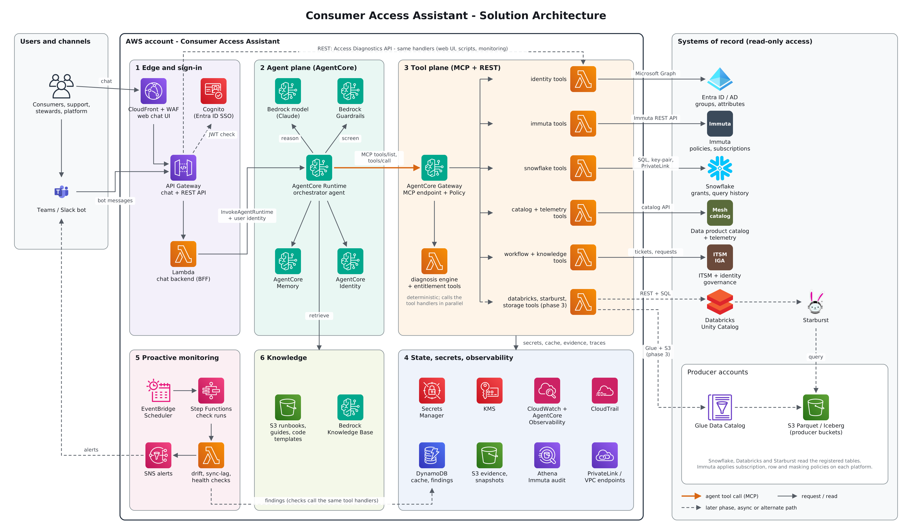

# Agentic Consumer Journey: Consumer Access Assistant

Design pack for an agentic chat assistant that diagnoses data access issues on the data mesh
and, later, guides consumer onboarding.

> **Status: design only (v1.0, 2026-11-10). Nothing here is implemented or has been run
> against real tenants.** Upstream API and SQL details were checked against vendor
> documentation; items marked VERIFY are confirmed in spike CAA-003 before build.

## The idea in four lines

1. Producers publish Parquet / Iceberg tables in S3; tables are registered on Snowflake,
   Databricks and Starburst; Immuta controls access using AD groups and user attributes.
2. When a consumer cannot see data, the cause is one broken link in a chain of six:
   identity, entitlements, policy, platform grants, session and the table itself.
3. A library of read-only **tools** collects the evidence; a deterministic **engine**
   compares the access a user *should* have with what they *actually* have.
4. A chat **agent** explains the result and the next step. The same tools drive
   **proactive monitoring** and, later, **consumer onboarding**.



## Start here

| If you are | Read |
|---|---|
| A sponsor or product owner | [`proposal/proposal.md`](proposal/proposal.md) and the deck beside it, then [`EPIC.md`](EPIC.md) and [`docs/01-solution-overview.md`](docs/01-solution-overview.md) |
| An architect or reviewer | [`docs/02-architecture.md`](docs/02-architecture.md), [`docs/adr/`](docs/adr/README.md), [`docs/07-security-and-governance.md`](docs/07-security-and-governance.md) |
| The developer who will build it | [`CLAUDE.md`](CLAUDE.md), [`docs/10-implementation-guide.md`](docs/10-implementation-guide.md), [`STORIES.md`](STORIES.md) |
| A platform owner being asked for access | [`docs/07-security-and-governance.md`](docs/07-security-and-governance.md) section 4, [`sql/snowflake/00_service_role_setup.sql`](sql/snowflake/00_service_role_setup.sql) |
| Anyone who needs to answer questions first | [`docs/12-assumptions-and-open-questions.md`](docs/12-assumptions-and-open-questions.md) |

## Contents

```
proposal/                       Management proposal: proposal.md and a six-slide deck (PowerPoint and HTML)
EPIC.md                         Epic definition for the tracker
STORIES.md                      73 user stories with acceptance criteria, by phase
CLAUDE.md                       Working agreement for Claude Code
copilot-instructions.md         Same for GitHub Copilot (move to .github/ to activate)
docs/
  01-solution-overview.md       Problem, goals, personas, the access chain, phases
  02-architecture.md            Diagram, components, flows, deployment, integrations
  03-tool-catalog.md            All 82 tools at a glance (generated)
  04-tool-specifications.md     Envelope, errors, authorisation, Phase 1 tool details
  05-agent-design.md            Playbooks, answer format, tool-use rules, topology
  06-diagnostic-model.md        Engine spec: layers, verdict matrix, root cause codes
  07-security-and-governance.md Identity, scopes, service identities, threat model
  08-nfr-observability-operations.md  NFRs, metrics, monitoring checks, runbook index
  09-testing-and-evaluation.md  Test pyramid, seeded personas, agent evals and gates
  10-implementation-guide.md    Stack, repo layout, patterns, build order, AI-assistant workflow
  11-consumer-onboarding-roadmap.md   Phase 4 design
  12-assumptions-and-open-questions.md  What to confirm before building
  adr/                          Seven architecture decision records
specs/tool-catalog.yaml         Machine-readable tool registry (source of truth)
api/openapi.yaml                REST contract for the MVP tools
sql/snowflake/                  Service role setup and one SQL template per Snowflake tool
config/examples/                Templates for organisation-specific configuration
prompts/system-prompt.md        Draft agent system prompt
evals/scenarios.yaml            Seed evaluation scenarios
diagrams/                       Architecture diagram (PNG, SVG, editable draw.io) and its sources
scripts/render_tool_catalog.py  Regenerates docs/03 from the YAML
```

## Phases

| Phase | Delivers |
|---|---|
| 0 Foundations | Decisions confirmed, service identities, verified API facts, skeleton |
| 1 MVP | Snowflake + Immuta + Entra ID tools, diagnosis engine, agent, chat API |
| 2 Depth and monitoring | Change history, tickets, proactive checks, web and Teams/Slack |
| 3 More platforms | Databricks, Starburst, producer storage |
| 4 Onboarding | Prerequisites, live checklist, sample code, guided requests |

## First five things to do

1. Answer the **blocking** questions in `docs/12` (identity model, Immuta set-up, RLS and PI
   implementation, telemetry and catalog sources, hosting approval).
2. Ask each platform owner for the read-only service identities listed in `docs/07` section 4.
3. Run spike **CAA-003** to verify every upstream call and SQL template and record fixtures.
4. Seed the test personas (**CAA-006**).
5. Build to milestone **M1**: `diagnose_table_access` giving correct verdicts for every
   persona from a command line, before any agent exists.

## Regenerating generated files

```bash
pip install pyyaml diagrams cairosvg
python scripts/render_tool_catalog.py     # docs/03-tool-catalog.md
python diagrams/architecture.py           # diagrams/architecture.{svg,png}
```
