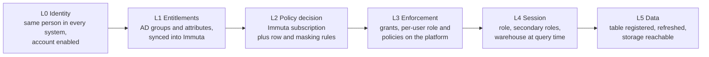

# 01 - Solution Overview

**Working name:** Consumer Access Assistant (CAA) &nbsp;|&nbsp; **Programme:** Agentic Consumer Journey
**Status:** Design, not yet implemented &nbsp;|&nbsp; **Version:** 1.0 (2026-11-10)

## 1. Context

The data mesh platform works like this today:

1. **Producers** publish data to their own S3 buckets as Parquet or Apache Iceberg tables.
2. Tables are **registered** on consumer platforms: Snowflake, Databricks and Starburst.
3. **Immuta** controls access. Subscription policies decide who can see a table. Data policies decide which rows (row-level security) and which column values (PI masking) a person sees.
4. Policy decisions are driven by **AD groups** and **user attributes**.

A consumer's access to one table therefore depends on a chain that crosses five systems. When any link is missing, the consumer sees a generic error ("object does not exist or not authorized"), zero rows, or masked values, and has no way to tell which link broke.

## 2. Problem

| Today | Effect |
|---|---|
| An access question needs someone to check AD, Immuta, the platform's grants, and query history by hand | Slow resolution; platform engineers act as a helpdesk |
| The same error message covers many different causes | Tickets are routed to the wrong team and bounce |
| Row-level and masking outcomes are silent (no error) | Consumers assume the data is wrong or missing |
| "Is this user *supposed* to have access?" is a judgement made from memory | Inconsistent answers; risk of over-granting to make the ticket go away |
| Sync lag between AD, Immuta and the platform is invisible | Users retry and re-raise requests that are already in progress |
| New consumers do not know the prerequisites | Long, uneven onboarding |

## 3. What we are building

A chat assistant, backed by an agent and a library of read-only diagnostic tools, that:

1. **Takes a problem in plain language** ("I can't query `SALES.CUSTOMER_ORDERS` in Snowflake", "I only see 3 accounts", "SSN shows as NULL").
2. **Gathers evidence** from Entra ID / AD, Immuta, Snowflake (then Databricks and Starburst), platform telemetry, and the data product catalog.
3. **Decides two things separately**: what access the user is *supposed* to have (from policy and entitlements) and what access they *actually* have (from platform grants and query evidence).
4. **Explains the gap** with a root cause, the evidence behind it, and the exact next step: request a named AD group, activate secondary roles, wait for sync, or escalate to a named team with the evidence pack attached.
5. **Monitors proactively** on a schedule for the same classes of fault (integration health, entitlement drift, sync lag, failure spikes), so many issues are known before a user reports them.

Later, the same tools serve a **consumer onboarding** journey: prerequisites, access requests, and sample code in the consumer's language.

## 4. Goals and non-goals

### Goals

- G1. Resolve "why can't I access X" without a human in the loop for the common causes.
- G2. Give a correct, evidence-backed answer to "what access does this user have" across systems.
- G3. Make row-level and PI outcomes explainable.
- G4. Detect platform-side sync faults before users do.
- G5. Expose every capability as a reusable tool (MCP and REST), so an existing agent or a new one can use it.
- G6. Lay the base for consumer onboarding.

### Non-goals (for this epic)

- The assistant does **not grant access** or change policy, grants, groups or attributes. It diagnoses and routes. Write actions are limited to raising tickets and escalations, with user confirmation.
- It does **not read business data rows**. All checks use metadata, entitlements, policy definitions and query history.
- It does not replace Immuta, the identity governance tool, or the ITSM tool. It reads from them.
- It does not judge whether a policy is *right*. It reports what the policy says.

## 5. Users

| Persona | What they need | Scope in the assistant |
|---|---|---|
| **Data consumer** (analyst, data scientist, engineer) | "Why can't I see this, and what do I do" | `self`: own access only |
| **Support engineer / platform helpdesk** | Diagnose on behalf of a user, with full evidence | `support`: any user, read-only |
| **Data steward / data product owner** | Who can see my product, are policies enforced | `steward`: own data products |
| **Platform engineer** (Snowflake, Immuta, IAM) | Sync faults, drift, escalations with evidence | `platform`: all, including storage tools |
| **Governance / security** | Over-entitlement findings | Receives findings; not a chat user in v1 |
| **New consumer** (Phase 4) | Prerequisites, requests, sample code | `self` |

## 6. Core idea: the access chain

Every diagnosis walks the same six layers. This is the mental model for the whole solution and is specified in [06-diagnostic-model.md](06-diagnostic-model.md).

The verdict comes from comparing **expected** access (L0 to L2) with **actual** access (L3 to L5):

| Expected | Actual | Meaning | What the assistant does |
|---|---|---|---|
| Yes | Yes | Access is fine; the problem is session context, SQL, or compute | Tells the user exactly what to change (for example `USE SECONDARY ROLES ALL`) |
| Yes | No | Platform or sync defect | Escalates to the owning platform team with evidence; tells the user it is not their fault |
| No | No | Working as designed | Tells the user precisely what is missing and how to request it |
| No | Yes | Over-entitlement | Files a governance finding silently; does not advertise it to the end user |

## 7. Capabilities by phase

| Phase | Capability | Outcome |
|---|---|---|
| **0** | Foundations: repo, IaC, identity, secrets, connectivity, spike on API facts | A deployable skeleton and confirmed integration facts |
| **1 (MVP)** | Snowflake + Immuta + Entra ID tools; table-access diagnosis; failed-query triage; RLS and PI answers; chat API | A consumer can self-diagnose Snowflake access problems |
| **2** | Depth (login failures, change history, compare users), ITSM and escalation, proactive monitoring, web / Teams UI | Faults found before users report them; evidence-rich escalations |
| **3** | Databricks and Starburst tools; producer storage checks; specialist sub-agents | Same experience on all three platforms |
| **4** | Consumer onboarding: prerequisites, checklist status, sample code, guided requests | Faster, consistent onboarding |

## 8. Solution at a glance

- **Tools first.** 82 tools are catalogued in [03-tool-catalog.md](03-tool-catalog.md); 32 form the MVP. Each tool is a small, read-only function with a strict contract, implemented once and exposed two ways: as an **MCP tool** through Amazon Bedrock AgentCore Gateway (for agents) and as a **REST endpoint** through Amazon API Gateway (for UIs, scripts and the monitoring pipeline).
- **Deterministic core, conversational shell.** Set comparison ("does this user's entitlement satisfy this policy") is done in code by a diagnosis engine. The language model plans, asks clarifying questions, and explains. It never computes an access verdict from raw data on its own.
- **One agent to start, specialists later.** The MVP is a single orchestrating agent on AgentCore Runtime. When Databricks and Starburst arrive, platform specialist sub-agents sit behind the same orchestrator.
- **Proactive monitoring reuses the tools.** Scheduled checks call the same handlers and write findings the agent can read.

Architecture: [02-architecture.md](02-architecture.md). Agent behaviour: [05-agent-design.md](05-agent-design.md).

## 9. Success measures

| Measure | Baseline | Target (6 months after MVP) |
|---|---|---|
| Median time to diagnose an access issue | Capture during Phase 0 | Under 2 minutes in chat |
| Share of access tickets resolved without a platform engineer | Capture during Phase 0 | 60% or more |
| Diagnosis accuracy on the golden scenario set | n/a | 95% or more correct root cause |
| Mis-routed access tickets | Capture during Phase 0 | Down by half |
| Sync faults detected by monitoring before the first user report | 0% | 70% or more |
| Wrong "you should have access" answers | n/a | 0 in the golden set; every production case reviewed |

Baselines are not known yet. Story CAA-005 captures them from the ITSM tool before MVP launch.

## 10. Document map

| # | Document | Read it for |
|---|---|---|
| 01 | Solution overview (this file) | Why and what |
| 02 | [Architecture](02-architecture.md) | Components, flows, deployment, diagram |
| 03 | [Tool catalog](03-tool-catalog.md) | Every tool at a glance |
| 04 | [Tool specifications](04-tool-specifications.md) | Contracts, SQL, API calls, edge cases |
| 05 | [Agent design](05-agent-design.md) | Prompt, playbooks, orchestration, guardrails |
| 06 | [Diagnostic model](06-diagnostic-model.md) | Access chain, verdict logic, root cause codes |
| 07 | [Security and governance](07-security-and-governance.md) | Identity, authorisation, data handling, threats |
| 08 | [NFRs, observability, operations](08-nfr-observability-operations.md) | SLOs, monitoring, runbook |
| 09 | [Testing and evaluation](09-testing-and-evaluation.md) | Test strategy and agent evals |
| 10 | [Implementation guide](10-implementation-guide.md) | Repo layout, build order, prompts for Claude Code |
| 11 | [Consumer onboarding roadmap](11-consumer-onboarding-roadmap.md) | Phase 4 design |
| 12 | [Assumptions and open questions](12-assumptions-and-open-questions.md) | What must be confirmed before build |
| - | [ADRs](adr/) | Why key decisions were made |
| - | [`EPIC.md`](../EPIC.md), [`STORIES.md`](../STORIES.md) | Backlog |
