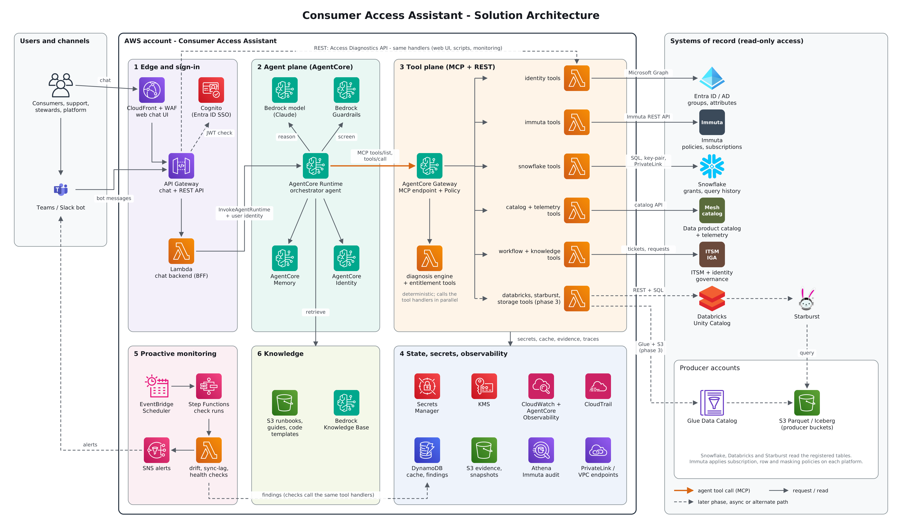
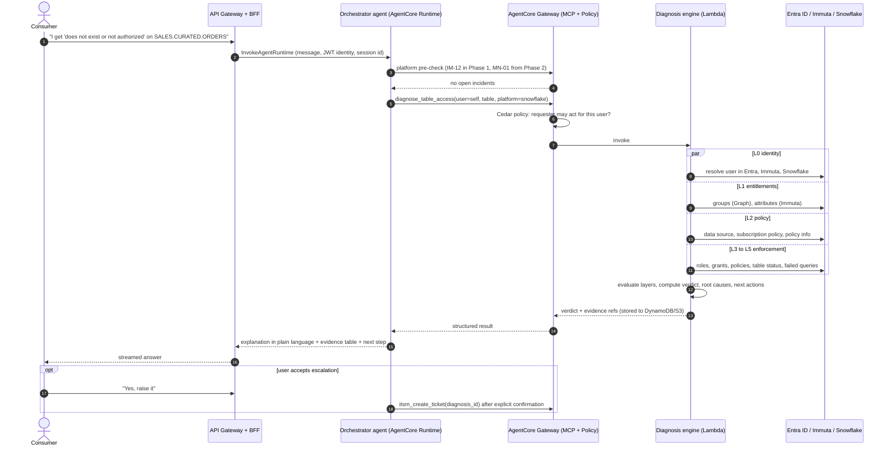
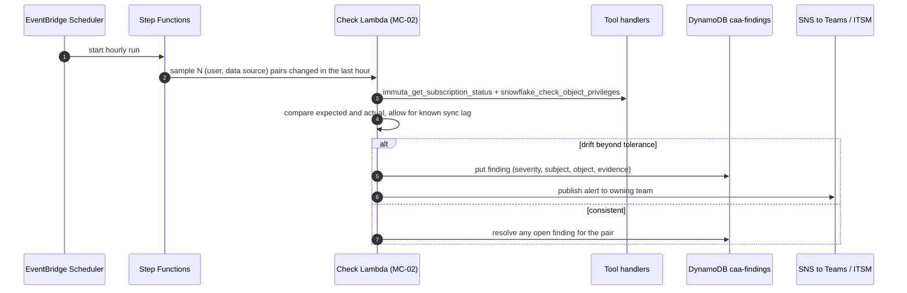
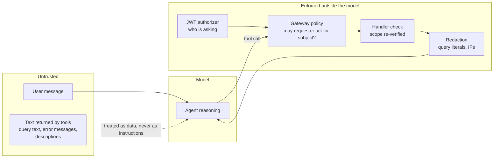

# 02 - Architecture

## 1. Architecture diagram

Source: [`diagrams/architecture.py`](../diagrams/architecture.py) (diagram as code; re-run to regenerate the PNG and SVG). Amazon Bedrock AgentCore components are drawn with the Amazon Bedrock icon and labelled, because the icon set used has no dedicated AgentCore icon.

## 2. Design principles

| # | Principle | Consequence |
|---|---|---|
| P1 | **Tools are the product.** The agent is one consumer of them. | Every capability is a small tool with a strict contract, reachable over MCP and REST. An existing agent can adopt them without this agent. |
| P2 | **Deterministic verdicts.** | "Should this user have access" is computed in code (`caa_core`), never inferred by the model from raw payloads. |
| P3 | **Read-only by default.** | Service identities in every source system hold read/metadata privileges only. The only writes are tickets and escalations, after confirmation. |
| P4 | **No business data.** | Tools read metadata, entitlements, policies and query history. They never select rows from data products. |
| P5 | **The requester is whoever the token says.** | Identity comes from the signed token and is enforced outside the model. Chat text cannot change who is asking or whose data is returned. |
| P6 | **Evidence or it did not happen.** | Every claim in an answer links to an evidence record with source and timestamp. |
| P7 | **Say how fresh the data is.** | Lagged sources (for example Snowflake `ACCOUNT_USAGE`) return `data_as_of`; the agent states the lag when it matters. |
| P8 | **Ports and adapters for anything organisation-specific.** | Catalog, telemetry, ITSM and identity governance sit behind interfaces so the unknowns do not block the core. |

## 3. Components

### 3.1 Edge and sign-in

| Component | AWS service | Role |
|---|---|---|
| Web chat UI | S3 + CloudFront + AWS WAF | Static single-page chat client. Optional in Phase 1 (API-first), delivered in Phase 2. |
| Chat channel bot | Teams or Slack app | Posts messages to the chat API. Phase 2. |
| Sign-in | Amazon Cognito user pool federated to Entra ID (OIDC/SAML) | Issues JWTs carrying the user's UPN and group claims that map to assistant scopes. If the organisation prefers, Entra ID can be the direct OIDC issuer and Cognito is dropped (see [ADR-006](adr/ADR-006-identity-and-authorization.md)). |
| API | Amazon API Gateway (HTTP API, JWT authorizer) | Two route groups: `/chat/*` (conversation) and `/v1/*` (Access Diagnostics REST API). |
| Chat backend (BFF) | AWS Lambda | Validates the session, calls `InvokeAgentRuntime` with the user identity, streams the reply. |

### 3.2 Agent plane

| Component | Service | Role |
|---|---|---|
| Orchestrator agent | Amazon Bedrock AgentCore Runtime | Hosts the agent (Strands Agents SDK, Python). Session-isolated, long-running, framework-agnostic. |
| Model | Amazon Bedrock (Anthropic Claude, Sonnet class for the orchestrator; a smaller model for classification and summarising) | Model ids are configuration, pinned per environment. |
| Guardrails | Amazon Bedrock Guardrails | Prompt-attack detection, PII filters on output, denied topics. |
| Memory | AgentCore Memory | Short-term conversation state; long-term per-user preferences (preferred platform, usual data products). No entitlement data is stored in long-term memory. |
| Identity | AgentCore Identity | Inbound: validates the user JWT. Outbound: workload identity and token vault for tool credentials; on-behalf-of tokens for the optional probe (SF-15). |
| Knowledge | Amazon Bedrock Knowledge Bases over an S3 corpus | Runbooks, access guides, FAQs, onboarding docs, error catalog narrative. |

### 3.3 Tool plane

| Component | Service | Role |
|---|---|---|
| MCP endpoint | AgentCore Gateway | Presents all tools as one MCP server. Lambda targets. Semantic tool search keeps the agent's context small as the catalog grows. |
| Tool authorisation | Policy in AgentCore (Cedar) on the Gateway | Enforces scope rules per tool call outside the model: a `self` requester can only pass their own identity as `user`. |
| Tool handlers | AWS Lambda, one function per domain | `caa-tools-identity`, `-immuta`, `-snowflake`, `-entitlement` (includes the diagnosis engine), `-catalog`, `-workflow`, and later `-databricks`, `-starburst`, `-aws`. |
| Shared library | Lambda layer `caa_core` | Envelope, authorisation check (defence in depth), identity resolution, policy evaluation, diagnosis engine, redaction, caching, structured logging, connectors. |
| REST projection | API Gateway `/v1/*` to the same Lambda functions | For the UI, scripts, other teams and the monitoring pipeline. Contract in [`api/openapi.yaml`](../api/openapi.yaml). |

Why Lambda per domain and not per tool: connections and credentials are per source system, cold starts are shared, and IAM and network egress are scoped per system. Tool routing inside a function is a dictionary lookup on tool name.

### 3.4 State, secrets, observability

| Store | Service | Content | Retention |
|---|---|---|---|
| Cache | DynamoDB `caa-cache` (TTL) | Identity resolution, data source lookups, policy definitions | 2 to 15 minutes |
| Findings | DynamoDB `caa-findings` | Monitoring findings and platform incidents | 90 days |
| Diagnoses | DynamoDB `caa-diagnoses` + S3 `caa-evidence` | Diagnosis record and evidence pack | 400 days (audit) |
| Snapshots | S3 `caa-snapshots` (Parquet, partitioned by date) | Daily access snapshots for diff-over-time | 400 days |
| Immuta audit | S3 (Immuta UAM export) + Athena | Query surface for Immuta audit events | Per Immuta export policy |
| Secrets | AWS Secrets Manager, KMS CMK | Immuta API key, Snowflake key pair, Graph client credential, ITSM credential | Rotated |
| Telemetry | CloudWatch Logs and metrics, AgentCore Observability (OpenTelemetry traces), CloudTrail | Tool latency, errors, token usage, traces, API audit | 30 to 400 days by class |

### 3.5 Proactive monitoring

EventBridge Scheduler starts Step Functions state machines that run check Lambdas. Checks call the same tool handlers as the agent, write findings to `caa-findings`, and publish to SNS for Teams/Slack and the ITSM tool. The agent reads findings with `monitor_get_platform_status` and `monitor_get_findings`, and always checks platform status first.

| Check | Schedule | Detects |
|---|---|---|
| MC-01 Integration health | 5 min | Immuta integration disabled or failing validation |
| MC-02 Entitlement drift | Hourly (sampled), nightly (full) | Immuta says subscribed but platform grant missing, and the reverse |
| MC-03 Sync lag | 15 min | Time from AD group change to Immuta entitlement to platform grant, using a canary identity |
| MC-04 Failure spike | 15 min | Sudden rise in authorisation-class query failures per table or data product |
| MC-05 Iceberg staleness | 30 min | Consumer-side snapshot behind the producer's current snapshot beyond tolerance |
| MC-06 Orphaned access | Nightly | Platform access for users disabled in the directory |
| MC-07 Canary query | 15 min | Synthetic consumer can still read a canary table on each platform |

Details and thresholds: [08-nfr-observability-operations.md](08-nfr-observability-operations.md).

## 4. Key flows

### 4.1 Reactive: "I can't query this table"

### 4.2 Proactive: entitlement drift

### 4.3 Tool call path and trust boundaries

## 5. Deployment view

| Aspect | Design |
|---|---|
| Accounts | One workload account per environment (`dev`, `test`, `prod`). Cross-account read role into producer accounts only in Phase 3. |
| Region | One primary Region where AgentCore Runtime, Gateway and the chosen Bedrock model are all available and where data residency rules are met. Confirm in CAA-002. |
| Network | Lambda functions and AgentCore egress in private subnets. Snowflake and Databricks over AWS PrivateLink where the organisation already has it. Immuta SaaS and Microsoft Graph over a NAT with an egress allow-list, or private connectivity if Immuta is self-hosted. VPC endpoints for S3, DynamoDB, Secrets Manager, KMS, CloudWatch, Bedrock. |
| IaC | AWS CDK (Python) or Terraform, matching the platform team's standard. Decision recorded in the implementation guide. |
| CI/CD | GitHub Actions or CodePipeline: lint, unit tests, contract tests, `cdk diff`/`plan`, deploy to dev, run eval suite, gated promotion. |
| Configuration | Git-versioned YAML in `config/` (scope, group prefixes, attribute map, RLS models, PI classification, error catalog, request routes) loaded at cold start, with environment overrides in SSM Parameter Store / AppConfig. |
| Environments | `dev` uses recorded fixtures and a Snowflake/Immuta non-prod tenant. `prod` tools are read-only against production metadata. |

## 6. Technology choices

| Concern | Choice | Alternatives considered | Record |
|---|---|---|---|
| Agent hosting | AgentCore Runtime | Bedrock Agents (action groups); self-managed on ECS/Lambda | [ADR-001](adr/ADR-001-agent-platform.md) |
| Agent framework | Strands Agents SDK | LangGraph; plain SDK loop | ADR-001 |
| Tool protocol | MCP through AgentCore Gateway, plus REST projection | REST only; in-process tools | [ADR-002](adr/ADR-002-tools-as-mcp-and-rest.md) |
| Verdict logic | Deterministic engine in code | Model-computed verdicts | [ADR-003](adr/ADR-003-deterministic-diagnosis-engine.md) |
| Agent topology | Single orchestrator first; specialists in Phase 3 | Multi-agent from day one | [ADR-004](adr/ADR-004-agent-topology.md) |
| Source access | Service identity, metadata only; optional on-behalf-of probe | Run everything as the user; broad admin roles | [ADR-005](adr/ADR-005-service-identity-metadata-only.md) |
| Identity and authorisation | JWT at the edge, Cedar policy on the Gateway, re-check in handlers | Trust the agent to enforce | [ADR-006](adr/ADR-006-identity-and-authorization.md) |
| Snowflake freshness | `ACCOUNT_USAGE` first, with stated lag; live paths where cheap | Live `SHOW` commands everywhere | [ADR-007](adr/ADR-007-snowflake-data-freshness.md) |

## 7. Integration summary

| System | Interface | Auth | Service identity needs | Notes |
|---|---|---|---|---|
| Entra ID / AD | Microsoft Graph v1.0 | OAuth 2.0 client credentials (app registration) | `User.Read.All`, `GroupMember.Read.All`; `AuditLog.Read.All` for ID-06 | If AD is on-prem only and not synced, replace with an LDAP adapter behind the same port. |
| Immuta | REST API v1 (BIM, data source, policy), Integrations API | API key exchanged for a bearer token | A dedicated Immuta service user with `AUDIT`, `FETCH_POLICY_INFO` and `GOVERNANCE` (read use only; see security doc for the trade-off) | UAM audit export to S3 for IM-14. Immuta's Agentic Access API (public preview) is noted in ADR-005 as a future option. |
| Snowflake | SQL via the Python connector | Key-pair for a `TYPE = SERVICE` user | Role `CAA_DIAG_READER` with `SNOWFLAKE` database roles; setup in [`sql/snowflake/00_service_role_setup.sql`](../sql/snowflake/00_service_role_setup.sql) | Dedicated XS warehouse, query tag on every statement. |
| Databricks | Unity Catalog REST, SCIM, SQL warehouse | OAuth M2M service principal | Read on system tables, `USE CATALOG`/`BROWSE` as needed | Phase 3. The platform is run by another team; raise the service principal request early. |
| Starburst | Trino client, REST | Service account | Read on system and information schema | Phase 3. |
| Mesh catalog, telemetry | Existing APIs or tables | To be confirmed | Read | Behind `CatalogPort` and `TelemetryPort`. |
| ITSM, identity governance | REST | OAuth or basic with vault | Read; create ticket | Behind `ItsmPort` and `IgaPort`. |

## 8. Sizing and cost drivers

No volumes are known yet, so this lists drivers and not numbers. Story CAA-005 collects the inputs.

| Driver | What moves it | Control |
|---|---|---|
| Model tokens | Conversations per day, tool result size | Composite tools return compact results; raw payloads stay in S3; smaller model for classification |
| Snowflake credits | `ACCOUNT_USAGE` scans | XS warehouse with 60 s auto-suspend; time-bounded predicates on every query; cache; nightly materialisation for monitoring |
| Lambda and Gateway | Tool calls per diagnosis (about 12 to 18 for a full chain) | Parallel fan-out inside the engine counts as one Gateway call |
| Immuta API load | Calls per diagnosis | Cache policy definitions 10 minutes; use the audit export for history |
| Monitoring | Sample sizes and schedules | Sample changed pairs hourly; full reconciliation nightly |
