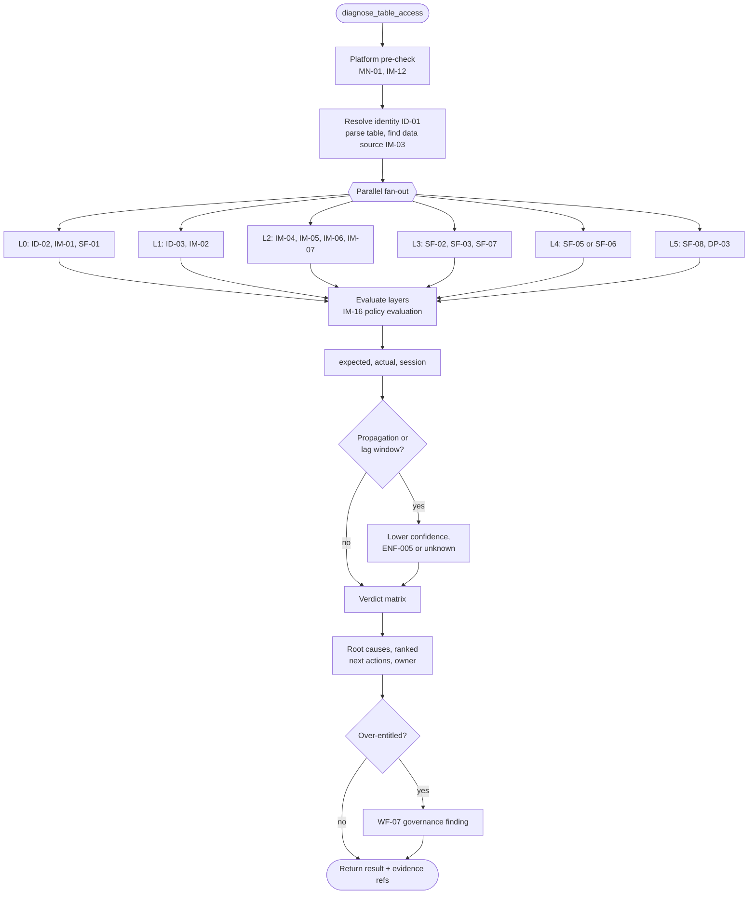

# 06 - Diagnostic Model

The logic the diagnosis engine (`caa_core.diagnosis`) implements. This is deterministic code. The language model explains the result; it does not produce it.

## 1. The access chain

A consumer can read a table only if every layer holds. The engine evaluates all layers (in parallel where independent) and does not stop at the first failure, because a user often has more than one gap and should hear about all of them at once.

| Layer | Question | Evidence (tools) | Typical failures |
|---|---|---|---|
| **L0 Identity** | Is this the same, enabled person in every system? | ID-01, ID-02, IM-01, SF-01 | Missing in Immuta or Snowflake, disabled, name mismatch |
| **L1 Entitlements** | Which groups and attributes do they hold, and have those reached Immuta? | ID-03, ID-04, IM-02 | Not in group, attribute missing, sync lag |
| **L2 Policy decision** | Given the policy, should they be subscribed? What rows and columns should they see? | IM-03, IM-04, IM-05, IM-06, IM-16, IM-07 | Not registered in Immuta, policy unmet, approval pending |
| **L3 Enforcement** | Has the platform been told? Role, grant, row and masking policies in place? | SF-02, SF-03, SF-07, IM-12 | Per-user role missing, grant missing, policy not attached, integration down |
| **L4 Session** | Did the failing query run with the right role, secondary roles, warehouse? | SF-05, SF-06, SF-01 | Secondary roles not active, wrong role, no warehouse |
| **L5 Data** | Does the table exist, is it current, can the platform read the storage? | SF-08, SF-11, DP-03, DP-06, AW-01..03 | Dropped or recreated, stale Iceberg metadata, S3/KMS denial |

A **platform pre-check** runs first: `monitor_get_platform_status` and `immuta_get_integration_status`. If a relevant incident is open, the engine still runs but puts `PLT-*` at the top of the root causes.

## 2. Expected versus actual

```
expected_access  = f(L0, L1, L2)      what policy says should be true
actual_access    = f(L3, L5)          what the platform will allow
session_ok       = f(L4)              whether the user's session could use it
```

| `expected_access` | Derived from |
|---|---|
| `yes` | Identity valid, and IM-05 says subscribed **or** IM-16 says the automatic policy is satisfied |
| `no` | Identity invalid, or policy unmet, or approval-type policy with no approved request |
| `approval_required` | Policy is approval-based and a request is pending or has not been raised |
| `unknown` | Policy could not be normalised, or a required source was unavailable |

| `actual_access` | Derived from |
|---|---|
| `yes` | Full privilege chain exists for the user's roles (SF-03) and the table exists (SF-08) |
| `no` | Any link missing, or table missing |
| `unknown` | Source unavailable, or grants are newer than the source lag can show |

### Verdict matrix

| Verdict | Expected | Actual | Session | Meaning | Lead action |
|---|---|---|---|---|---|
| `access_ok_session_issue` | yes | yes | not ok | User has access; the session did not use it | User fix (role, secondary roles, warehouse) |
| `access_ok_no_fault_found` | yes | yes | ok or n/a | Nothing wrong found; error is SQL, data or transient | Show the query error class; check L5 |
| `expected_yes_actual_no` | yes | no | - | Platform or sync defect | Escalate to platform team with evidence; tell the user it is not on them |
| `expected_no_actual_no` | no | no | - | Working as designed | Tell the user what is missing and how to request it |
| `approval_pending` | approval_required | no | - | Waiting on a person | Show who must approve and since when |
| `expected_no_actual_yes` | no | yes | - | Over-entitlement | File governance finding (WF-07). User-facing text: see section 6 |
| `data_unavailable` | any | any | - | L5 fault dominates | Route to producer or platform team |
| `inconclusive` | unknown | or unknown | - | Not enough evidence | Say exactly what could not be checked and offer escalation |

**Propagation rule.** Before declaring `expected_yes_actual_no`, the engine checks whether the entitlement or subscription changed within the configured propagation window (`config/sync-windows.yaml`, per hop: directory to Immuta, Immuta to platform, plus the lag of the source used to observe it). If so, the verdict is `expected_yes_actual_no` with root cause `ENF-005 propagation in progress`, confidence `medium`, and the action is "wait until HH:MM, then re-check" and not an escalation.

**Lag rule.** If `actual_access` relies on a lagged source and the user reports a change inside that lag, return `actual_access: unknown` and prefer a live check where one exists (ADR-007), or ask the user to retry and share the query id.

## 3. Root cause catalog

Codes are stable and appear in tool output, logs, metrics, tickets and evals. `Owner` is who can fix it. Full text and remediation templates live in `config/root-causes.yaml`.

### Identity (IDN)

| Code | Root cause | Owner | Standard next action |
|---|---|---|---|
| IDN-001 | No Immuta user for this person | IAM / Immuta admin | Check IAM sync; user may never have signed in or SCIM is not provisioning |
| IDN-002 | No Snowflake user | Snowflake platform | Raise platform onboarding request |
| IDN-003 | Snowflake user name differs from the name Immuta maps to | Immuta admin | Fix external user id mapping in Immuta |
| IDN-004 | More than one live platform identity matches | Snowflake platform | Remove the duplicate |
| IDN-005 | Directory account disabled | IAM | Contact manager / IAM |
| IDN-006 | Snowflake user disabled, locked or expired | Snowflake platform | Unlock / re-enable per runbook |
| IDN-007 | Immuta user disabled | Immuta admin | Re-enable |

### Directory and entitlements (DIR)

| Code | Root cause | Owner | Standard next action |
|---|---|---|---|
| DIR-001 | Not a member of a required AD group | User | Request the named group through the request route |
| DIR-002 | Required attribute missing or lacks the needed value | User / IAM | Request the attribute value |
| DIR-003 | Group is in the directory but not yet in Immuta | IAM / Immuta admin | Wait for sync if recent, else escalate |
| DIR-004 | Attribute is in the directory but not in Immuta, or mapped under another name | Immuta admin | Fix attribute mapping |
| DIR-005 | Group membership removed recently | User | Re-request; show who removed it and when (support scope) |
| DIR-006 | Membership is via a dynamic group whose rule the user no longer meets | IAM | Explain the rule; route to IAM |

### Policy and subscription (POL)

| Code | Root cause | Owner | Standard next action |
|---|---|---|---|
| POL-001 | Table is not registered as an Immuta data source | Data product owner / platform | Register; escalate with table name |
| POL-002 | Immuta data source disabled or unhealthy | Immuta admin | Escalate with health detail |
| POL-003 | Approval-based policy, no request raised | User | Request access in Immuta |
| POL-004 | Automatic policy not satisfied (see DIR codes for what is missing) | User | Follow the DIR action |
| POL-005 | Subscription expired or revoked | User / steward | Re-request; show date |
| POL-006 | Subscribed, but the row policy grants no rows | User / steward | Request the row-scope attribute |
| POL-007 | Access contract in the catalog disagrees with the live Immuta policy | Steward | Fix the contract or the policy |
| POL-008 | Purpose or project required and not active | User | Join the project / acknowledge the purpose |
| POL-009 | Column masked by policy; user lacks the PI entitlement | User | Request PI access if justified |

### Enforcement on the platform (ENF)

| Code | Root cause | Owner | Standard next action |
|---|---|---|---|
| ENF-001 | Immuta per-user role does not exist or is not granted to the user | Immuta admin | Escalate; integration sync |
| ENF-002 | Subscribed in Immuta but `SELECT` not granted on the platform | Immuta admin | Escalate; integration sync |
| ENF-003 | Immuta data policy exists but the row or masking policy is not attached on the platform | Immuta admin | Escalate as a governance-relevant defect |
| ENF-004 | `USAGE` on database or schema missing for every role the user holds | Snowflake platform | Grant per platform standard |
| ENF-005 | Change is inside the propagation window | - | Wait, then re-check |
| ENF-006 | Table was dropped and recreated; grants and policies were lost | Producer / platform | Re-sync Immuta; recreate with `COPY GRANTS` in future |
| ENF-007 | Access exists only through a non-Immuta role | Governance | Finding; see SEC-001 |

### Session (SES)

| Code | Root cause | Owner | Standard next action |
|---|---|---|---|
| SES-001 | Privileges are split across roles and secondary roles were not active | User | `USE SECONDARY ROLES ALL;` or set default secondary roles; BI tool connection setting |
| SES-002 | Query ran under a role that is not part of the access path | User | Switch role |
| SES-003 | No active warehouse, or no usable default warehouse | User / platform | `USE WAREHOUSE …`; request warehouse usage |
| SES-004 | No current database or schema and the name was not fully qualified | User | Qualify the name |

### Data availability (DAT)

| Code | Root cause | Owner | Standard next action |
|---|---|---|---|
| DAT-001 | Table does not exist on this platform (never registered or dropped) | Producer / platform | Check registration status |
| DAT-002 | Table name or case is wrong; a near match exists | User | Suggest the near match |
| DAT-003 | Iceberg metadata on the platform is behind the producer | Platform | Refresh; escalate |
| DAT-004 | Platform cannot read storage (S3 or KMS denial) | Producer / platform | Escalate with denying statement |
| DAT-005 | Column missing: schema changed | Producer | Notify producer; show schema change date |
| DAT-006 | Data product pipeline is late or failed (no new data, access is fine) | Producer | Show last successful load |

### Query and compute (QRY), platform (PLT), security (SEC)

| Code | Root cause | Owner | Standard next action |
|---|---|---|---|
| QRY-001 | SQL error unrelated to access | User | Show the error class and position |
| QRY-002 | Statement or warehouse timeout | User / platform | Larger warehouse, narrower query |
| QRY-003 | Warehouse suspended by resource monitor | Platform | Escalate to warehouse owner |
| PLT-001 | Immuta integration unhealthy | Immuta admin | Link the incident; no user action |
| PLT-002 | Directory-to-Immuta sync delayed beyond SLO | IAM / Immuta admin | Link the incident |
| PLT-003 | Platform incident declared | Platform | Link the incident |
| SEC-001 | Actual access exceeds expected access | Governance | Silent finding |
| SEC-002 | Access held by an account disabled in the directory | Governance | Silent finding |

## 4. Policy condition tree

Immuta policies are normalised to this small structure (IM-06, IM-09) so the evaluator is simple and testable.

```
node      := group | attribute | everyone | approval | unsupported | and | or
group     := { "kind": "group", "name": str }
attribute := { "kind": "attribute", "name": str, "value": str }
everyone  := { "kind": "everyone" }
approval  := { "kind": "approval", "approvers": [str] }
unsupported := { "kind": "unsupported", "raw": str }
and / or  := { "op": "AND" | "OR", "children": [node] }
```

Evaluation returns `satisfied: true | false | unknown` for each node. `unsupported` is `unknown`; `AND` with an `unknown` and no `false` is `unknown`; `OR` with any `true` is `true`. Group and attribute comparisons use the case rules configured for the Immuta tenant (default: exact match, **VERIFY**).

## 5. Row-level and masking reasoning

| Question | Engine approach |
|---|---|
| Which rows can the user see? | Ask Immuta (IM-07). Translate with the table's RLS model (`attribute` or `lookup_table`) into a list of scope values. Do not count or sample rows. |
| Why fewer rows than expected? (DX-03) | `missing = expected_values - visible_values`. For each missing value, show which attribute value or mapping row would grant it and its request route. If nothing is missing by policy, the cause is not RLS; check data (DAT-006). |
| Why zero rows? | Subscribed + row filter + empty scope = `POL-006`. Subscribed + scope non-empty = likely data or predicate; say so. |
| Why is a column masked? (DX-04) | Column is tagged PI and the user does not meet the policy exception: `POL-009`, with `unmask_requires`. |
| Is masking enforced? | Immuta says masked and Snowflake shows a masking policy on the column. A mismatch is `ENF-003`. |

`config/rls-models.yaml` (one entry per table or per data product):

```yaml
- match: { platform: snowflake, table: "SALES.CURATED.*" }
  model: attribute
  scope_dimension: account_id
  attribute: AccountAccess
  all_values_token: "ALL"
- match: { platform: snowflake, table: "FINANCE.CURATED.LEDGER" }
  model: lookup_table
  scope_dimension: account_id
  lookup:
    table: GOV.ENTITLEMENTS.USER_ACCOUNT_MAP
    user_column: USER_NAME
    value_column: ACCOUNT_ID
```

## 6. Handling over-entitlement

When actual access exceeds expected access, the engine:

1. Writes a finding (`SEC-001`) with evidence to `caa-findings` and publishes to the governance topic (WF-07). This happens inside the engine, not at the model's discretion.
2. Returns verdict `expected_no_actual_yes` to the agent together with `user_message_policy: "neutral"`.
3. The agent, for a `self` requester, answers the question that was asked (their access works) without describing the gap as a way to keep access. For `support` and above it shows the finding.

This prevents the assistant from becoming a tool for discovering or preserving unintended access, and it keeps the governance team informed.

## 7. Evidence model

```json
{
  "id": "ev-01JCD0X4",
  "diagnosis_id": "dx-01JCD0X1",
  "layer": "L3_enforcement",
  "source": "snowflake.account_usage.grants_to_roles",
  "tool": "snowflake_check_object_privileges",
  "retrieved_at": "2026-11-10T10:21:44Z",
  "data_as_of": "2026-11-10T08:21:44Z",
  "claim": "No role held by the user has SELECT on SALES.CURATED.ORDERS",
  "payload_ref": "s3://caa-evidence/2026/11/10/dx-01JCD0X1/ev-01JCD0X4.json",
  "sensitivity": "internal"
}
```

Each root cause lists the evidence ids that support it. The agent's answer cites evidence by a short label ("Snowflake grants, as of 08:21 UTC"). A root cause without evidence is a bug and fails the contract tests.

## 8. Confidence

| Confidence | Rule |
|---|---|
| `high` | All layers evaluated from live or sufficiently fresh sources; the root cause explains the observed error |
| `medium` | One relevant source was lagged or partial, or the propagation rule applied |
| `low` | Verdict `inconclusive`, or the root cause was inferred from a pattern without direct evidence |

The agent states medium and low confidence in words and says what would raise it.

## 9. Engine flow



Time budget: 12 s overall, 8 s per source. A source that misses its budget makes its layer `not_evaluated` and appears in `unchecked`.
