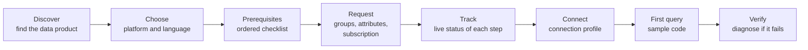

# 11 - Consumer Onboarding Roadmap (Phase 4)

The diagnostic assistant answers "why can't I". Onboarding answers "how do I". Both run on the same tools: a prerequisite checklist is the access chain read forwards, and each checklist item is verified by a tool that already exists.

## 1. The journey



| Stage | Consumer asks | Tools | New in Phase 4 |
|---|---|---|---|
| Discover | "Is there customer order data I can use?" | DP-01, DP-02, WF-01 | - |
| Choose | "Should I use Snowflake or Databricks? I write PySpark." | DP-02 (platforms registered), OB-04 | Platform guidance content |
| Prerequisites | "What do I need?" | **OB-01** | Yes |
| Request | "Raise the requests for me" | **OB-05** (write, confirmed), WF-05 | Yes |
| Track | "Where am I?" | **OB-02** (uses ID-04, IM-05, SF-01, SF-03, WF-05) | Yes |
| Connect | "How do I connect from Python?" | **OB-04** | Yes |
| First query | "Give me starter code" | **OB-03** | Yes |
| Verify | "It failed" | DX-01, DX-02 | - |

## 2. Prerequisite model

A data product on a platform has an ordered list of steps. Each step has a verifier, so status is computed, not self-reported.

```yaml
# config/onboarding/prerequisites/snowflake.yaml (template; merged with the data product's access contract)
- id: platform_account
  title: Snowflake account
  why: You need a Snowflake user before any data access can be granted.
  verifier: { tool: snowflake_get_user, pass_when: "found and not disabled" }
  request: { route: itsm, item: "Snowflake onboarding" }
  typical_lead_time: 1 business day
- id: consumer_group
  title: "AD group {access_contract.groups[*]}"
  why: Immuta subscribes members of this group to the data product automatically.
  verifier: { tool: idp_check_group_membership, pass_when: "is_member" }
  request: { route: iga, item: "{group}" }
  typical_lead_time: 1 to 2 business days (manager and data owner approval)
- id: attributes
  title: "Attribute {name} = {value}"
  why: Determines which rows you can see.
  verifier: { tool: immuta_get_user_entitlements, pass_when: "attribute present" }
- id: immuta_subscription
  title: Immuta subscription active
  verifier: { tool: immuta_get_subscription_status, pass_when: "state == subscribed" }
- id: platform_grant
  title: Access visible in Snowflake
  verifier: { tool: snowflake_check_object_privileges, pass_when: "full chain" }
- id: session_setup
  title: Secondary roles enabled
  why: Your table access comes from an Immuta-managed role alongside your working role.
  verifier: { tool: snowflake_get_user, pass_when: "default_secondary_roles == ALL (the Snowflake default unless overridden)" }
  self_service: "ALTER USER … or USE SECONDARY ROLES ALL; (per platform standard)"
- id: pi_access            # optional
  title: PI access (only if you need unmasked personal data)
  optional: true
  verifier: { tool: entitlement_get_pi_access, pass_when: "has_pi_entitlement" }
```

Lead times in this example are placeholders; real values come from the owning teams.

`OB-02` returns each step as `done`, `pending` (requested, waiting) or `blocked` (cannot start until an earlier step completes), with the evidence and the next step to take.

## 3. Sample code

**Principle: templates, not improvisation.** Connection patterns are a security matter (authentication method, secret handling, network path). The generator fills reviewed templates; the model may adapt the query and explain the code but does not invent a connection pattern.

| Platform | Languages / clients at launch | Auth patterns |
|---|---|---|
| Snowflake | Python connector, Snowpark Python, JDBC (Java), SQL worksheet, dbt profile | SSO (external browser), key-pair for service users, OAuth |
| Databricks | PySpark notebook, Databricks SQL connector (Python), JDBC, dbt profile | OAuth U2M, service principal |
| Starburst | Trino Python client, JDBC, SQL | OAuth / SSO per cluster setup |

Template layout:

```
templates/sample-code/
  snowflake/python/sso/        main.py.j2  README.md.j2  requirements.txt.j2
  snowflake/snowpark/sso/
  snowflake/java/keypair/
  databricks/pyspark/notebook/
  starburst/python/oauth/
```

Each template: sets secondary roles (Snowflake), uses the recommended warehouse or compute from the connection profile, never embeds a secret, selects named columns with a `LIMIT`, and includes a short "what you should see" note that reflects the user's row scope and masked columns (from EN-01 and EN-02). That last point is the differentiator: the sample tells the consumer in advance that `CUSTOMER_EMAIL` will be hashed and that they will see three accounts, so the first result is not a surprise.

Every template is executed in CI against the seeded personas, so published samples are known to run.

## 4. Onboarding agent behaviour

- Starts from the consumer's goal, not from forms: "I need order data for APAC in a notebook."
- Shows the checklist with live status, and offers to raise outstanding requests in one confirmation.
- Remembers the journey (long-term memory: chosen data product, platform, language) and resumes: "Your group request was approved this morning. Two steps left."
- Can notify the consumer when a pending step completes (scheduled re-check, opt-in).
- Hands over to the diagnostic playbooks when a step fails.

## 5. What Phase 4 needs from earlier phases

| Dependency | From |
|---|---|
| Access contracts per data product | DP-02 (Phase 1) |
| Verifier tools | Phases 1 to 3 |
| Request routes and identity governance adapter | WF-05 (Phase 2) |
| Write-with-confirmation pattern | Phase 2 |
| Connection profiles per platform and environment | New content, owned by platform teams |
| Reviewed code templates | New content, owned by platform teams and security |

## 6. Measures

| Measure | Target direction |
|---|---|
| Time from first question to first successful query | Down |
| Access requests raised with the wrong item or group | Down |
| Onboarding tickets to the platform helpdesk | Down |
| Share of new consumers whose first query succeeds | Up |
| Steps most often blocked, by owning team | Feed to those teams |

## 7. Later ideas

- Producer onboarding: the mirror journey for registering a data product (checks on Iceberg metadata, Glue, registration, Immuta tagging).
- Recommendations: "people in your team also use…", from telemetry.
- Access reviews: periodic "you have not used this in 90 days" prompts, with steward sign-off.
- Self-healing for safe fixes (for example re-triggering an Immuta sync) behind approval. This would be the first step beyond read-only and needs its own risk review.
